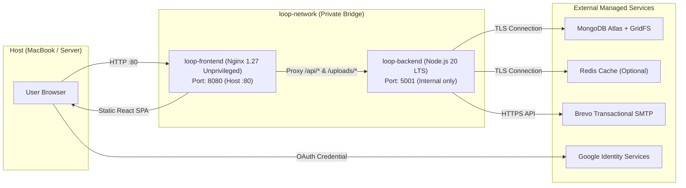

# LOOP SPIT — Production Dockerization Guide

This guide provides end-to-end instructions for building, orchestrating, testing, and deploying the LOOP SPIT platform using Docker and Docker Compose on macOS (Apple Silicon / Intel with Docker Desktop) and production Linux servers.

---

## 1. Architecture & Networking Overview

The containerized architecture separates concerns between static asset delivery and dynamic API processing:



### Key Security & Isolation Features:
- **Zero Root Execution:** Both containers run as unprivileged users (`node` with UID 1000 in backend, `nginx` with UID 101 in frontend).
- **Private Internal Network:** The backend is inaccessible from the public internet or external host network by default; all traffic is routed through Nginx reverse proxy.
- **Graceful Termination:** The backend captures `SIGTERM` and `SIGINT` signals, draining active HTTP requests before closing MongoDB Atlas and Redis connections cleanly.
- **Single Origin (No CORS Issues):** Because Nginx serves the React application and proxies `/api/` to the backend internally, browser requests share the exact same origin (`http://localhost`).

---

## 2. Prerequisites

1. **Docker Desktop for Mac:** Install from [docker.com](https://www.docker.com/products/docker-desktop/).
2. Verify Docker is running:
   ```bash
   docker --version
   docker compose version
   docker info
   ```

---

## 3. Configuration & Environment Setup

Copy the environment template to create your local `.env` file at the root of the project:

```bash
cp .env.example .env
```

Edit `.env` with your preferred configuration:
- `MONGODB_URI`: Your MongoDB Atlas connection string.
- `JWT_SECRET`: A secure random string of at least 32 characters (generate with `openssl rand -hex 32`).
- `RESET_SECRET`: A secure random string for hashing password-reset OTPs.
- `FRONTEND_PORT`: Host port to expose (default: `80`, or change to `3000` / `8080` if port 80 is occupied on your Mac).
- `BREVO_API_KEY`: Brevo API key starting with `xkeysib-` (for password reset emails).
- `GOOGLE_CLIENT_ID`: Your Google OAuth Web Client ID for institutional `@spit.ac.in` logins.

> [!NOTE]
> `.env` is strictly ignored by `.gitignore` and `.dockerignore`. Secrets are never baked into Docker images or committed to Git.

---

## 4. Building & Running with Docker Compose

### 4.1 Build Images
Build both frontend and backend Docker images:
```bash
docker compose build
```

To build without using cache (clean rebuild):
```bash
docker compose build --no-cache
```

### 4.2 Start Services in Detached Mode
```bash
docker compose up -d
```

### 4.3 Check Container Health & Status
```bash
docker compose ps
```
Both containers will display `Up (healthy)`.

### 4.4 View Live Logs
View all logs:
```bash
docker compose logs -f
```

View backend logs only:
```bash
docker compose logs -f backend
```

View frontend logs only:
```bash
docker compose logs -f frontend
```

---

## 5. Verification & Health Probing

### 5.1 Test Frontend & SPA Fallback
Open your browser to:
```
http://localhost
```
*(Or `http://localhost:<FRONTEND_PORT>` if you modified `FRONTEND_PORT`).*

Verify curl response:
```bash
curl -I http://localhost/
```

### 5.2 Test Backend Health via Reverse Proxy
```bash
curl http://localhost/health
```
Expected output:
```json
{
  "status": "healthy",
  "service": "loop-backend",
  "version": "2.2.0-gridfs-streaming",
  "dbState": "connected",
  "uptime": 45,
  "timestamp": "2026-10-29T12:00:00.000Z"
}
```

### 5.3 Test API Endpoint Connectivity
```bash
curl http://localhost/api/settings/visibility
```

---

## 6. Common Operations & Troubleshooting

### Stopping Services
```bash
docker compose down
```

To stop and remove containers along with networks:
```bash
docker compose down --remove-orphans
```

### Rebuilding After Code Changes
When you make changes to frontend or backend source files:
```bash
docker compose up -d --build
```

### Port 80 Permission or Conflict on macOS
If port 80 is already used or requires root privileges on your machine:
1. Open `.env` and change:
   ```env
   FRONTEND_PORT=3000
   ```
2. Restart:
   ```bash
   docker compose up -d
   ```
3. Access at `http://localhost:3000`.

### Direct Backend Access for Debugging
If you need direct host access to the backend port for local API tooling:
Uncomment the `ports` mapping in `docker-compose.yml`:
```yaml
ports:
  - "5001:5001"
```
Then restart with `docker compose up -d`.

---

## 7. Production Cloud Deployment Options

### Option A: AWS Elastic Container Service (ECS) or Google Cloud Run
1. Authenticate with your container registry (e.g. AWS ECR or Google Artifact Registry):
   ```bash
   docker tag loop-backend:latest <registry>/loop-backend:latest
   docker tag loop-frontend:latest <registry>/loop-frontend:latest
   docker push <registry>/loop-backend:latest
   docker push <registry>/loop-frontend:latest
   ```
2. Deploy backend as a private internal service.
3. Deploy frontend with an Application Load Balancer (ALB) or Cloud Run HTTPS ingress.
4. Pass secrets via AWS Secrets Manager or GCP Secret Manager.

### Option B: Single VM (Docker + Traefik / Caddy)
1. Provision an Ubuntu / Debian VM (e.g., on AWS EC2, DigitalOcean, or Linode).
2. Install Docker and Docker Compose.
3. Clone repository and set production `.env`.
4. Run `docker compose up -d`.
5. Point DNS for your institutional domain to the VM and terminate TLS using Caddy or Let's Encrypt Nginx.
