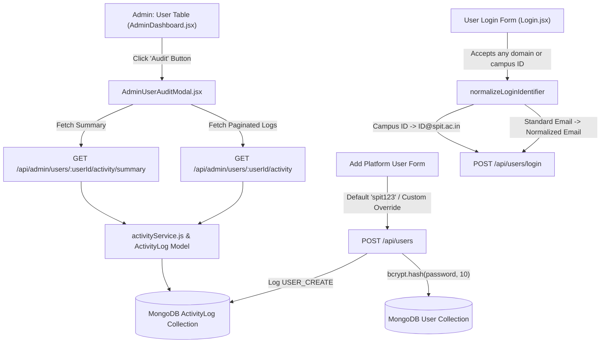

# LOOP — Administrator User Intelligence, Complete Audit Trail & Email Authentication Fix Report

**Project:** Life of Other Placements (LOOP)  
**Date:** October 18, 2026  
**Status:** Completed & Verified  
**Scope:** Full-Stack Security, Authentication, Administration & Audit Intelligence Architecture  

---

## Executive Summary

LOOP's administrative capabilities and user access layer have been upgraded to provide complete user intelligence, robust audit trail tracking, secure password provisioning, and flexible email domain authentication.

### Core Problems Identified & Resolved
1. **Institutional Domain Lockout:** `Login.jsx` and `normalizeLoginIdentifier` strictly blocked valid non-institutional email addresses (e.g., `@gmail.com`, `@outlook.com`), preventing legitimate students, contributors, and alumni from logging into their accounts.
2. **Missing Credential Hashing on Admin User Creation:** When creating users via "Add Platform User" in the admin dashboard, the password was saved as `null` if not provided, leaving new accounts in an unusable credential state where no login attempt could succeed.
3. **No Individual User Audit Visibility:** While platform-wide logs existed in a generic admin tab, administrators lacked the ability to inspect an individual user's specific history, login patterns, uploads, profile updates, and administrative interventions directly from the user roster.
4. **Audit Trail Coverage Gaps:** User creation, deletion, story moderation, resource approval/rejections, and password reset actions were missing structured activity logging with clear attribution of actions performed **BY** the user versus actions performed **ON** the user by administrators.

---

## Architecture & Implementation Overview

---

## Detailed Implementation Breakdown

### 1. Simulated Platform Users Table & Audit Icon Column
- **File:** [AdminDashboard.jsx](file:///Users/swapnil/Base%20Zero%20/Placement/PROJECT%20FILE/frontend/src/pages/AdminDashboard.jsx)
- Added an **"Activity / Audit"** column in the Simulated Platform Users table.
- Implemented an accessible button for each user row featuring the `History` icon, dedicated tooltip (`title="View activity for this user"`), and descriptive screen-reader label (`aria-label={`View activity audit trail for ${u.email}`}`).
- Maintained responsive horizontal scrolling with compact cell formatting preserving existing "Edit" and "Delete" actions.

### 2. Dedicated User Activity / Audit Modal
- **File:** [AdminUserAuditModal.jsx](file:///Users/swapnil/Base%20Zero%20/Placement/PROJECT%20FILE/frontend/src/components/AdminUserAuditModal.jsx)
- **Header Profile Card:** Displays the inspected user's email, role badge, status badge, profile details (name, branch, year), and account creation timestamp with keyboard accessibility (Escape to dismiss).
- **Summary Metrics Grid:** Nine live aggregate cards:
  - Total Recorded Events
  - Successful Logins
  - Failed Login Attempts
  - Resource Uploads
  - Resource Deletions
  - Profile Updates
  - Password Events
  - Admin Actions & Interventions
  - Most Recent Activity Timestamp
- **Action Direction Attribution:** Distinguishes whether an event was a user self-action (`BY_USER`) or an administrator action performed on the user (`ON_USER_BY_ADMIN`), such as role adjustments or moderations.
- **Filtering & Search:** Real-time text search and category selector buttons (`ALL`, `AUTH`, `PROFILE`, `CONTENT`, `ADMIN`, `SECURITY`, `FEEDBACK`).
- **Sanitized Metadata Inspector:** Expandable metadata drawer displaying sanitized event identifiers, target details, IP address, and user-agent details without exposing credentials or tokens.

### 3. Dedicated Admin User Activity & Intelligence Endpoints
- **File:** [server.js](file:///Users/swapnil/Base%20Zero%20/Placement/PROJECT%20FILE/backend/server.js) & [activityService.js](file:///Users/swapnil/Base%20Zero%20/Placement/PROJECT%20FILE/backend/services/activityService.js)
- `GET /api/admin/users/:userId/activity`: Returns paginated activity events for a specific user ID or email address, filtered by category and search keyword. Protected by `authenticateToken` and `requireAdmin`.
- `GET /api/admin/users/:userId/activity/summary`: Aggregates activity metrics from persisted database logs.
- Added `targetUserEmail` field to `ActivityLogSchema` in [models.js](file:///Users/swapnil/Base%20Zero%20/Placement/PROJECT%20FILE/backend/models.js) with compound indexing `{ targetUserEmail: 1, createdAt: -1 }`.

### 4. Default Password Management & Account Provisioning Fix
- **Default Password Decision:** `spit123` is established as the canonical default password for newly provisioned accounts.
- **UI Clarification:** "Add Platform User" clearly displays `spit123` in a highlighted badge accompanied by a 1-click **Copy to Clipboard** button with transient confirmation feedback (`Copied!`).
- **Custom Password Override:** An optional override input field allows administrators to specify an explicit initial password if desired.
- **Hashing & Authentication Guarantee:** `POST /api/users` hashes the chosen or default initial password via `bcrypt.hash(initialPassword, 10)` before persistence, ensuring the user can immediately log in.

### 5. Email Domain Normalization & Fallback Resolution
- **Files:** [server.js](file:///Users/swapnil/Base%20Zero%20/Placement/PROJECT%20FILE/backend/server.js) & [Login.jsx](file:///Users/swapnil/Base%20Zero%20/Placement/PROJECT%20FILE/frontend/src/pages/Login.jsx)
- Removed restrictive `@spit.ac.in` domain assertions from `Login.jsx` and `normalizeLoginIdentifier`.
- Standard email format (`/^[^\s@]+@[^\s@]+\.[^\s@]+$/`) is now validated for any legitimate email domain (`@gmail.com`, `@outlook.com`, `@yahoo.com`, etc.).
- Preserved SPIT campus username fallback: identifiers without an `@` symbol (e.g., `2021.swapnil.patil`) continue to resolve seamlessly to `${username}@spit.ac.in`.
- Updated UI copy in `Login.jsx` from "Sign in with your verified @spit.ac.in account" to "Sign in with your verified account or SPIT ID".

### 6. Platform Audit Coverage & Credential Sanitization
- Extended audit logging to cover:
  - User creation (`USER_CREATE`) in `POST /api/users` and `POST /api/users/register-request`
  - User deletion (`USER_DELETE`) in `DELETE /api/users/:email`
  - Password recovery requests (`AUTH_PASSWORD_RESET_REQ`) and completion (`AUTH_PASSWORD_RESET_SUCCESS`)
  - Password updates (`AUTH_PASSWORD_CHANGE`) in profile modifications
  - Moderation actions: story submission (`CONTENT_STORY_SUBMIT`), approval (`CONTENT_STORY_APPROVE`), rejection (`CONTENT_STORY_REJECT`), and resource moderation (`CONTENT_RESOURCE_SUBMIT`, `CONTENT_RESOURCE_REJECT`, `ADMIN_APPROVE_RESOURCE`)
- Fixed typo in `activityService.js` `SENSITIVE_KEYS` set to ensure `resettoken` and `resettokenhash` are always sanitized alongside passwords, API keys, and JWT secrets.

---

## Verification & Automated Test Results

### 1. Dedicated Verification Test Suite
- **File:** [adminUserAuditAndEmailAuth.test.js](file:///Users/swapnil/Base%20Zero%20/Placement/PROJECT%20FILE/backend/tests/adminUserAuditAndEmailAuth.test.js)
- 16 test cases covering:
  - Email domain acceptance & username fallback normalization
  - Metadata sanitization of credentials and tokens
  - `getUserActivity` filtering, search, and action direction tagging
  - `getUserActivitySummary` metric aggregation
  - Password default hashing & custom password override
  - Root admin delete protection
  - RBAC verification (401/403 for non-admins)
- **Result:** **16 passing, 0 failing (100% pass rate)**

### 2. Comprehensive Backend Test Suite
- Executed `npm test` across all 22 test suites in `backend/tests/`.
- **Result:** **174 passing, 0 failing, 0 skipped**

### 3. Frontend Production Build
- Executed `npm run build` in `frontend/`.
- Built successfully in 340ms with zero bundling or syntax warnings.

---

## File Modification Log

| File Path | Action | Description |
|---|---|---|
| `backend/models.js` | Modified | Added `targetUserEmail` and compound index to `ActivityLogSchema`; expanded `eventType` and `category` enums |
| `backend/services/activityService.js` | Modified | Added `getUserActivity` and `getUserActivitySummary`; added `targetUserEmail` support; fixed `resettoken` sanitization |
| `backend/server.js` | Modified | Removed `@spit.ac.in` restriction in `normalizeLoginIdentifier`; added default `spit123` hashing; added user activity and summary endpoints; expanded audit event triggers |
| `frontend/src/utils/db.js` | Modified | Added `getAdminUserActivity` and `getAdminUserActivitySummary` API clients |
| `frontend/src/pages/Login.jsx` | Modified | Removed institutional domain restriction on login; updated input labels and subtexts |
| `frontend/src/components/AdminUserAuditModal.jsx` | Created | Built full user activity audit modal with metrics summary, filters, search, and inspection drawer |
| `frontend/src/pages/AdminDashboard.jsx` | Modified | Added "Activity / Audit" column and button to table; updated "Add Platform User" with default password notice and copy button; integrated audit modal |
| `backend/tests/loginFormats.test.js` | Modified | Updated test assertions to reflect allowed non-SPIT domains and hashed default password |
| `backend/tests/adminUserAuditAndEmailAuth.test.js` | Created | Comprehensive automated test suite for all new features |
