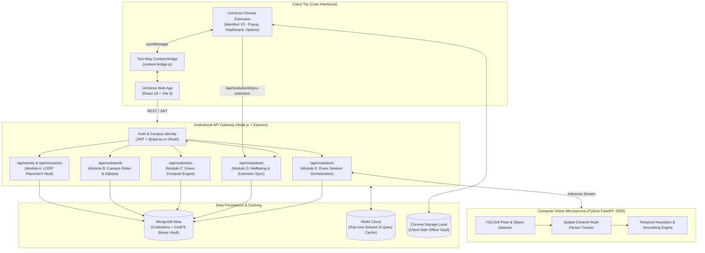

# UniVerse — An Intelligent, Sustainable, and Privacy-Aware Campus Ecosystem

### *"Their Journey. Your Campus."*

[](https://react.dev/)
[](https://nodejs.org/)
[](https://www.mongodb.com/)
[](extension/)
[](https://fastapi.tiangolo.com/)
[](DOCKER.md)
[](https://vitejs.dev/)
[](https://tailwindcss.com/)
[-success?style=flat-square)](backend/tests/)
[](COPYRIGHT)

> **UniVerse** is an institutional campus super-app built for **Sardar Patel Institute of Technology (SPIT), Mumbai**. It unifies senior placement intelligence, smart carbon-neutral ride-pooling, sustainable green computing, client-side digital wellbeing with an official Chrome extension, and ethical, human-authoritative examination monitoring into a single, privacy-first university ecosystem.

---

## 📑 Table of Contents

1. [Executive Overview: What is UniVerse?](#1-executive-overview-what-is-universe)
2. [The 5 Subsystem Modules](#2-the-5-subsystem-modules)
   - [Module A: Student Intelligence & Academic Vault (LOOP Core)](#module-a-student-intelligence--academic-vault-loop-core)
   - [Module B: Smart Campus Ride-Pooling & Trust System](#module-b-smart-campus-ride-pooling--trust-system)
   - [Module C: Sustainable Computing Observatory](#module-c-sustainable-computing-observatory)
   - [Module D: Privacy-Aware Digital Wellbeing & Chrome Extension (MV3)](#module-d-privacy-aware-digital-wellbeing--chrome-extension-mv3)
   - [Module E: Responsible Examination Monitoring & AI Vision Pipeline](#module-e-responsible-examination-monitoring--ai-vision-pipeline)
3. [System Architecture Diagram](#3-system-architecture-diagram)
4. [Technology Stack](#4-technology-stack)
5. [Codebase Directory Structure](#5-codebase-directory-structure)
6. [Quick Start & Local Development](#6-quick-start--local-development)
7. [Chrome Extension Installation Guide](#7-chrome-extension-installation-guide)
8. [Comprehensive REST API Reference](#8-comprehensive-rest-api-reference)
9. [Automated Verification & Test Suite](#9-automated-verification--test-suite)
10. [Ethics, Privacy Guarantees & Intellectual Property](#10-ethics-privacy-guarantees--intellectual-property)

---

## 1. Executive Overview: What is UniVerse?

Higher-education institutions manage complex student interactions across disparate, fragmented, and vulnerable third-party platforms:
- Placement advice gets lost in ephemeral WhatsApp and Telegram chats.
- Commuting students travel in solo auto-rickshaws, driving up costs and carbon emissions.
- Campus compute servers run heavy workloads inefficiently during peak carbon grid intensity.
- Students face digital distraction and burnout from invasive monitoring extensions that scrape personal data.
- Exam integrity relies on either intrusive biometric eye-trackers or human proctors overwhelmed by 60-student exam halls.

**UniVerse** replaces these disconnected tools with a unified, sovereign institutional super-app engineered specifically for campus life:

```
                    ┌──────────────────────────────────────────────┐
                    │               UniVerse Platform              │
                    │         "Their Journey. Your Campus."        │
                    └───────────────────────┬──────────────────────┘
                                            │
        ┌───────────────┬───────────────────┼───────────────────┬───────────────┐
        ▼               ▼                   ▼                   ▼               ▼
   [Module A]      [Module B]          [Module C]          [Module D]      [Module E]
 Placement Vault   Campus Rides       Green Compute      Wellbeing Nudge  Exam Integrity
```

---

## 2. The 5 Subsystem Modules

### Module A: Student Intelligence & Academic Vault (LOOP Core)
- **Status:** Production Active & Preserved
- **Core Mission:** Institutional career guidance and decentralized academic mentorship.
- **Key Capabilities:**
  - **Round-by-Round Interview Debriefs:** Direct firsthand accounts from SPIT seniors detailing company recruitment rounds (Microsoft, Google, Amazon, Morgan Stanley, J.P. Morgan Chase, PhonePe, Barclays, Deutsche Bank).
  - **Departmental 4-Year Roadmaps:** Curated technical prep pathways for CSE, CE, and EXTC.
  - **200MB GridFS Binary Vault:** High-speed streaming storage for senior resumes, interview notes, and syllabus resources with in-browser PDF previews.
  - **Institutional Verification:** Contributor access restricted to verified campus emails (`@spit.ac.in`).

---

### Module B: Smart Campus Ride-Pooling & Trust System
- **Status:** Fully Implemented & Tested
- **Mount Point:** `/api/modules/b` • **Frontend Route:** `/campus-rides`
- **Core Mission:** Safe, carbon-neutral peer ride sharing for daily transit to/from campus nodes.
- **Key Capabilities:**
  - **Priority-Queue Dijkstra Routing:** Graph mobility across 10 campus nodes and transit stations (Andheri Station, Bhavan's Campus, SPIT Main Gate, Azad Nagar Metro) across 18 bidirectional segments.
  - **Multi-Stop Topological Insertion:** Dynamic intermediate waypoint insertion with deterministic match scoring (0–100), bounded detours, and passenger pickup ETAs.
  - **Auditable Carbon Offset Ledger:** Computes real CO₂ savings based on the $120\text{g } \text{CO}_2/\text{km}$ automotive baseline, stored in `StudentSustainabilityOutcome`.
  - **Verified Peer Trust:** Post-ride ratings (1–5 stars) restricted strictly to confirmed co-riders, with private admin safety reporting and opt-in driver WhatsApp contact sharing.

---

### Module C: Sustainable Computing Observatory
- **Status:** Fully Implemented & Integrated
- **Mount Point:** `/api/modules/c` • **Frontend Route:** `/green-compute`
- **Core Mission:** Scientific carbon modeling and off-peak compute scheduling for college projects.
- **Key Capabilities:**
  - **Deterministic Simulation Engine:** Mulberry32 PRNG provides 100% reproducible baseline vs. optimized experiments across arbitrary seeds and durations.
  - **3 Specialized Campus Workloads:**
    1. *Campus Core API (`campus_api`):* Request-response caching optimization.
    2. *Student Analytics Worker (`analytics_worker`):* Event streaming micro-batching.
    3. *Media Pipeline (`media_processor`):* Vectorized OCR and image processing.
  - **Rigorous Grid Carbon Formulation:**
    - Power: $P_{\text{avg}} = P_{\text{idle}} + u \cdot (P_{\text{max}} - P_{\text{idle}})$ (Watts)
    - Energy: $E = \frac{P_{\text{avg}} \cdot t}{3{,}600{,}000}$ (kWh)
    - Emissions: $C = E \cdot I_{\text{grid}}$ (kg CO₂e), calibrated to the India Central Electricity Authority baseline ($0.708\text{ kg CO}_2\text{e/kWh}$).
  - **Interactive Observatory UI:** Real-time KPI cards, comparative SVG area/bar charts, and run comparison ledgers.

---

### Module D: Privacy-Aware Digital Wellbeing & Chrome Extension (MV3)
- **Status:** Fully Implemented, Integrated & Available as Chrome MV3 Extension
- **Mount Point:** `/api/modules/d` • **Frontend Route:** `/digital-wellbeing` • **Extension Path:** `extension/`
- **Core Mission:** Client-controlled study sessions, distraction analytics, and mindful focus habits without covert surveillance.
- **Key Capabilities:**
  - **Zero-Surveillance Privacy Engine:**
    - *Active-Only Gating:* Tab tracking operates **strictly** during active focus sessions. When paused or idle, monitoring shuts down completely.
    - *Zero Incognito Tracking:* Incognito windows and tabs are 100% ignored.
    - *Hostname-Only Logging:* Strips URL paths, search queries, hashes, and session tokens.
    - *Zero Keystrokes / Content Scraping:* Never inspects form inputs, passwords, or page contents.
    - *Right-to-be-Forgotten:* One-click local data wipe and JSON export.
  - **Chrome Extension (Manifest V3):**
    - Compact toolbar popup with real-time focus timer and live domain categorization.
    - Background service worker (`service-worker.js`) with persistent timestamp duration math across worker sleep cycles and dynamic badges (`12m` active, `⏸` paused).
    - Full-page extension analytics dashboard with context switch counters and distraction ratios.
    - Full-featured options page to manage custom rules and focus goals.
  - **Live Bidirectional Web Bridge:**
    - Auto-detects extension on `http://localhost:5173/digital-wellbeing`.
    - Automatically syncs login authentication tokens between the website and extension.
    - Displays live browser focus status on the web dashboard: `● Live Focus Session in Browser: 14m on github.com`.
    - One-click `Sync Extension Stats` button synchronizes completed sessions to MongoDB Atlas.

---

### Module E: Responsible Examination Monitoring & AI Vision Pipeline
- **Status:** Production Active with High-Speed YOLOv8 Vision Microservice
- **Mount Point:** `/api/modules/e` • **Frontend Route:** `/exam-monitoring` • **Vision Port:** `5005`
- **Core Mission:** Ethical, multi-student CCTV exam hall surveillance assisting human invigilators with zero facial biometrics.
- **Key Capabilities:**
  - **Multi-Student CCTV Spatial Detection:** Engineered specifically for wide-angle exam halls with multiple candidates where single-person facial landmark meshes fail.
  - **Upper-Body Skeletal Pose Estimation:** YOLOv8-pose 17-keypoint model tracks nose, ear, and shoulder vectors even when candidates sit with heads downward over physical test papers.
  - **Centroid Proximity Multi-Object Tracking:** Combines Hungarian IoU matching with desk centroid proximity recovery, assigning stable temporary labels (`Candidate #01`, `Candidate #02`...).
  - **Adaptive Running Baseline Yaw:** Compensates for oblique CCTV camera angles ($0.95 \cdot \text{baseline} + 0.05 \cdot \text{yaw}$).
  - **Supported Observable Events:**
    1. *Repeated Head Turns:* Direction reversal counting over sliding 5s windows.
    2. *Phone-Like Object Detection:* Proximity check within candidate desk bounding box with 2-frame temporal streak confirmation.
    3. *Prolonged Neighbor Orientation:* Sustained lateral turn $>65\%$ of window frames.
    4. *Restricted Zone Monitoring:* Configurable podium/boundary polygon alert.
  - **Forensic Evidence Snapshots:** Downscaled base64 snapshots watermarked with candidate bounding boxes and event labels.
  - **Candidate-Wise Spatial Breakdown:** Interactive candidate cards with individual event counts and single-click table filtering.
  - **Auditable Human Review & Multi-Format Exports:** Invigilators can mark incidents as `Reviewed`, `Dismissed (False Positive)`, or `Resolved`. Downloadable JSON audit reports, CSV logs, and printable institutional PDF reports.

---

### Candidate Repositories Evaluation & Architectural Selection

To engineer a resilient multi-student surveillance pipeline suitable for distant CCTV cameras, 8 candidate GitHub exam monitoring repositories were audited:

| Repository | Multi-Person CCTV? | Input Types | Core Models & Methods | CCTV Distant Footage Suitability | License / Architectural Decision |
| :--- | :---: | :--- | :--- | :--- | :--- |
| **1. Sania-hasann/Cheating-Surveillance-System** | ❌ Single Person | Webcams | Dlib 68-Facial Landmarks + Roboflow YOLO Phone | Fails on distant CCTV; facial landmarks require large frontal faces. | MIT. Architectural inspiration for phone proximity logic; replaced Dlib with YOLOv8-pose. |
| **2. muhammadraza77/Exam-Surveillance** | ⚠️ Limited | Video Streams | OpenCV Cascades + Activity Logging | Cascades suffer from high false negatives under seated posture. | Academic. Replaced Haar cascades with deep PyTorch inference. |
| **3. vardanagarwal/Proctoring-AI** | ❌ Single Person | Webcams | BlazeFace + Dlib + Eye Gaze Mesh + Speech | Unsuitable for CCTV; relies on single-user webcam gaze and audio. | MIT. Excellent for online remote proctoring; inapplicable to exam halls. |
| **4. anirudh2019/Automated_proctoring_system** | ❌ Single Person | Webcams | FaceNet + Dlib 68 Landmarks + Lip Tracking | Incompatible with CCTV; facial mesh collapses at $>3\text{m}$ distances. | Apache 2.0. Inapplicable to hall monitoring. |
| **5. smog-root/SPROCTOR** | ⚠️ Partial | Recorded Video | YOLOv5 Person Count + Simple Heuristics | High track switching rate when candidates write or lean forward. | Open Source. Adapted concept; hardened tracker with centroid recovery. |
| **6. isacje/ExamProct** | ❌ Single Person | Webcams | OpenCV + Eye aspect ratio (EAR) | Fails on distant camera; EAR requires high-resolution iris tracking. | Unlicensed / Incompatible. Excluded from codebase. |
| **7. ShashankJangid/ai-exam-surveillance** | ✅ Multi-Person | CCTV / RTSP | YOLOv8 + Multi-Person Pose Estimation | **High Suitability.** 17-keypoint skeletal vectors remain robust in CCTV. | MIT. Selected as architectural reference for skeletal pose & orientation. |
| **8. sumitra-sumi/smart_exam_proctoring** | ✅ Multi-Person | Video Files / CCTV | YOLOv8 Person Count + Temporal Risk Scoring | **High Suitability.** Temporal windowing reduces single-frame false alerts. | MIT. Selected as reference for temporal streak rules and evidence snapshots. |

**Selected Architecture:** A unified microservice combining **YOLOv8 nano** object detection (`yolov8n.pt`), **YOLOv8 17-keypoint pose estimation** (`yolov8n-pose.pt`), and **Centroid Proximity Hungarian Tracking**, accelerated via Apple Silicon Metal Performance Shaders (`mps`) and NVIDIA `cuda`.

---

## 3. System Architecture Diagram



---

## 4. Technology Stack

| Layer | Technologies | Rationale & Capabilities |
| :--- | :--- | :--- |
| **Frontend** | React 19, Vite 8, Tailwind CSS, Lucide Icons | Next-gen tree-shaking, sub-50ms HMR, glassmorphic UI, responsive typography. |
| **Backend** | Node.js 20 LTS, Express 4.19 | High-concurrency async I/O, REST routing, CORS whitelisting, streaming uploads. |
| **Browser Extension** | Chrome Manifest V3, ES Modules | Pure local client-side focus state machine, alarms, zero-surveillance tab gating. |
| **Database** | MongoDB Atlas, Mongoose 8, GridFS | Managed replica set, schema validation, 200MB chunked binary document storage. |
| **Caching Layer** | Redis Cloud, in-memory fallback | Sub-1ms query caching, sliding token TTL, automatic connection fallback. |
| **Computer Vision** | Python 3.10+, FastAPI, PyTorch, YOLOv8-pose | Real-time 17-keypoint skeletal pose estimation, centroid multi-candidate tracking. |
| **DevOps & Containers** | Docker, Docker Compose, Nginx | Multi-stage production containerization, unprivileged non-root users, reverse proxy. |

---

## 5. Codebase Directory Structure

```text
Mini-project_hackathon/                    # Repository Root
├── backend/                               # Express API server & services
│   ├── modules/
│   │   ├── moduleB_ridePooling/          # Module B: Dijkstra router & ride-sharing
│   │   ├── moduleC_greenComputing/       # Module C: Mulberry32 simulation engine
│   │   ├── moduleD_digitalWellbeing/     # Module D: Focus sessions & sync routes
│   │   └── moduleE_examMonitoring/       # Module E: Video handler & CV integration
│   │       └── vision_service/           # FastAPI YOLOv8 computer vision runner (:5005)
│   ├── middlewares/                      # Auth, upload, and CORS guards
│   ├── services/                         # Storage, caching, and audit services
│   ├── tests/                            # Comprehensive automated test suites (61 suites, 441 tests)
│   ├── models.js                         # Mongoose schemas & compound indexes
│   ├── server.js                         # Central Express server entrypoint
│   └── package.json
│
├── extension/                            # Module D Chrome Extension (Manifest V3)
│   ├── manifest.json                     # MV3 schema, permissions, content_scripts
│   ├── background/
│   │   └── service-worker.js             # Service worker: active timer, alarms, sync
│   ├── content/
│   │   └── content-bridge.js             # Two-way bridge connecting web dashboard to extension
│   ├── shared/
│   │   ├── rulesEngine.js                # Domain normalization, matching & presets
│   │   ├── storage.js                    # chrome.storage.local abstraction with memory fallback
│   │   ├── sessionManager.js             # Timestamp elapsed duration & context switch math
│   │   └── syncClient.js                 # Authenticated UniVerse cloud sync client
│   ├── popup/                            # Compact toolbar popup controller & live timer
│   ├── dashboard/                        # Full-page analytics dashboard
│   ├── options/                          # Categorization rules & privacy settings editor
│   ├── assets/                           # Extension icons (16px, 32px, 48px, 128px)
│   ├── tests/                            # Automated extension unit tests
│   └── README.md                         # Extension architecture & setup guide
│
├── frontend/                             # React 19 + Vite 8 SPA
│   ├── src/
│   │   ├── components/                   # Reusable glassmorphic UI components (Navbar, Modals)
│   │   ├── pages/
│   │   │   ├── Landing.jsx               # Campus landing portal
│   │   │   ├── Stories.jsx               # Module A: Senior placement stories
│   │   │   ├── Resources.jsx             # Module A: Academic vault
│   │   │   ├── CampusRides.jsx           # Module B: Ride-pooling & network map
│   │   │   ├── GreenCompute.jsx          # Module C: Sustainable computing observatory
│   │   │   ├── DigitalWellbeing.jsx      # Module D: Wellbeing dashboard & extension bridge
│   │   │   ├── ExamMonitoring.jsx        # Module E: Invigilator examination dashboard
│   │   │   └── AdminDashboard.jsx        # Moderation & system logs
│   │   └── utils/                        # API clients across all modules
│   ├── public/                           # Static assets, logos, and licenses
│   ├── vite.config.js                    # Vite bundler & API reverse proxy configuration
│   └── package.json
│
├── docker-compose.yml                    # Multi-container orchestration
├── UNIVERSE_MODULES_ARCHITECTURE.md      # Detailed multi-module technical specification
└── README.md                             # You are here
```

---

## 6. Quick Start & Local Development

### Prerequisites
- **Node.js**: v20+ LTS
- **npm**: v10+
- **Python**: v3.10+ (for Module E vision microservice)
- **MongoDB Atlas Connection URI**

### 1. Clone the Repository
```bash
git clone https://github.com/manthanpalkar/Mini-project_hackathon.git
cd Mini-project_hackathon
```

### 2. Configure Environment Variables
Ensure `backend/.env` contains your MongoDB Atlas connection:
```env
PORT=5001
MONGODB_URI=mongodb+srv://<username>:<password>@loopuniversedev.ky5byth.mongodb.net/loop_universe_dev?retryWrites=true&w=majority
JWT_SECRET=your_jwt_secret_key_here
```

### 3. Start Backend API Server (Port 5001)
```bash
cd backend
npm install
npm run dev
# Server listening on http://localhost:5001
```

### 4. Start Frontend Client (Port 5173)
```bash
cd ../frontend
npm install
npm run dev
# Client ready at http://localhost:5173
```

### 5. Start Module E Computer Vision Microservice (Port 5005)
```bash
# Run from repository root:
python3 -m uvicorn backend.modules.moduleE_examMonitoring.vision_service.service:app --host 127.0.0.1 --port 5005

# Or from backend directory:
cd backend
python3 -m uvicorn modules.moduleE_examMonitoring.vision_service.service:app --host 127.0.0.1 --port 5005
```

---

## 7. Chrome Extension Installation Guide

1. Open **Google Chrome** and navigate to:
   ```text
   chrome://extensions
   ```
2. In the top-right corner, toggle **Developer mode** to **ON**.
3. In the top-left corner, click **Load unpacked**.
4. Select the `extension/` directory inside your cloned repository:
   ```text
   <path-to-cloned-repo>/Mini-project_hackathon/extension
   ```
5. Pin the **UniVerse Wellbeing** extension to your toolbar.
6. Open your UniVerse website at `http://localhost:5173/digital-wellbeing` — the **Extension Connected (MV3)** badge will appear automatically!
7. **Using the Extension**:
   - Click the extension icon in your Chrome toolbar ➔ click **Start Focus Session**.
   - Browse across academic and research tabs (e.g. GitHub, StackOverflow, arXiv).
   - Watch the live timer tick on the extension icon badge.
   - Return to the website: observe the live session indicator tracking your active browser time.
   - Click **Complete & Save** in the extension popup ➔ click **Sync Extension Stats** on the website to persist records to your UniVerse account.

---

## 8. Comprehensive REST API Reference

### Module A: Placement Stories & Academic Vault
| Method | Endpoint | Description |
| :--- | :--- | :--- |
| `GET` | `/api/stories` | Retrieve approved placement roadmaps with company and role filters. |
| `POST` | `/api/stories` | Submit new placement roadmap for administrative moderation. |
| `GET` | `/api/resources` | List academic vault documents and senior study resources. |
| `GET` | `/api/resources/file/:id` | High-speed GridFS parallel streaming binary download. |

### Module B: Smart Campus Ride-Pooling
| Method | Endpoint | Description |
| :--- | :--- | :--- |
| `GET` | `/api/modules/b/routes` | Priority-queue Dijkstra shortest path routing across campus nodes. |
| `POST` | `/api/modules/b/rides` | Publish new ride offer with vehicle capacity and waypoints. |
| `POST` | `/api/modules/b/rides/:id/request` | Request seat booking with automatic detour calculation. |
| `PATCH` | `/api/modules/b/rides/:id/status` | Advance ride state (`open` ➔ `scheduled` ➔ `in_transit` ➔ `completed`). |
| `POST` | `/api/modules/b/rides/:id/rate` | Submit peer feedback (1–5 stars) restricted to verified participants. |
| `GET` | `/api/modules/b/sustainability/stats` | Retrieve aggregate student CO₂ emissions offset and fuel savings. |

### Module C: Sustainable Computing Observatory
| Method | Endpoint | Description |
| :--- | :--- | :--- |
| `POST` | `/api/modules/c/simulate` | Run deterministic Mulberry32 PRNG compute simulation experiment. |
| `GET` | `/api/modules/c/history` | List historical simulation runs with aggregate carbon savings. |
| `GET` | `/api/modules/c/compare` | Side-by-side baseline vs. optimized workload comparative metrics. |

### Module D: Digital Wellbeing & Chrome Extension Sync
| Method | Endpoint | Description |
| :--- | :--- | :--- |
| `GET` | `/api/modules/d/health` | Health check, module metadata, and capability list. |
| `GET` | `/api/modules/d/sessions/active` | Inspect current active or paused focus session. |
| `POST` | `/api/modules/d/sessions/start` | Start focus session with title, category, and target minutes. |
| `POST` | `/api/modules/d/sessions/:id/pause` | Pause active focus session (freezes active time accumulation). |
| `POST` | `/api/modules/d/sessions/:id/resume` | Resume paused focus session. |
| `POST` | `/api/modules/d/sessions/:id/stop` | Finalize session duration and save self-reflection notes. |
| `GET` | `/api/modules/d/rules` | List user-defined categorization rules + system presets. |
| `POST` | `/api/modules/d/rules` | Create custom categorization rule (`domain_suffix`, `exact_host`, `contains`). |
| `POST` | `/api/modules/d/rules/preview` | Preview domain classification against active rule priority hierarchy. |
| `POST` | `/api/modules/d/events/generate-synthetic` | User-initiated reproducible synthetic demo generator (Mulberry32 PRNG). |
| `GET` | `/api/modules/d/analytics` | Aggregated active minutes, context switches, category distribution, and nudges. |
| `POST` | `/api/modules/d/privacy/clear-history` | Right-to-be-forgotten: irreversibly purge all focus sessions and events. |
| `POST` | `/api/modules/d/sync-extension` | Sync completed focus sessions and activity events from Chrome Extension. |
| `GET` | `/api/modules/d/extension/summary` | Extension-specific focus metrics, session counts, and top domains. |

### Module E: Responsible Examination Monitoring
| Method | Endpoint | Description |
| :--- | :--- | :--- |
| `GET` | `/api/modules/e/health` | Vision microservice health, MPS/CUDA accelerator, and active model status. |
| `GET` | `/api/modules/e/samples` | List authentic preloaded CCTV examination hall footage options. |
| `POST` | `/api/modules/e/upload` | Upload authorized custom exam footage (`.mp4`, `.avi`, `.mov`, `.mkv`). |
| `POST` | `/api/modules/e/sessions` | Initialize new examination monitoring session with room code and video path. |
| `POST` | `/api/modules/e/sessions/:id/start` | Start YOLOv8 inference pipeline and stream frames and telemetry. |
| `POST` | `/api/modules/e/sessions/:id/pause` | Pause active examination monitoring session. |
| `POST` | `/api/modules/e/sessions/:id/resume` | Resume paused examination monitoring session. |
| `POST` | `/api/modules/e/sessions/:id/stop` | Finalize examination monitoring session and flush audit metrics. |
| `GET` | `/api/modules/e/sessions/:id/incidents` | Fetch incidents filtered by candidate, event type, status, and confidence. |
| `PATCH` | `/api/modules/e/incidents/:id` | Human-in-the-loop review action (`Reviewed`, `Dismissed`, `Resolved`). |
| `GET` | `/api/modules/e/sessions/:id/report` | Comprehensive JSON examination audit report with candidate metrics. |
| `GET` | `/api/modules/e/sessions/:id/export/csv` | Download RFC 4180-compliant CSV incident and audit trail log. |

---

## 9. Automated Verification & Test Suite

UniVerse features a native test harness executed with Node's built-in test runner (`node --test`), covering all 5 modules (61 test suites, 441 automated tests) with zero external test runner bloat:

```bash
# 1. Run Complete Backend Multi-Module Test Suite (441 tests across 61 suites)
cd backend
node --test tests/*.test.js

# Or run specific module unit tests:
node --test tests/wellbeingCalculationsAndRules.test.js tests/wellbeingSessionLifecycle.test.js tests/extensionSyncEndpoint.test.js tests/universeModules.test.js

# 2. Run Chrome Extension Standalone Unit Tests (10 tests across 2 suites)
cd ../extension
node --test tests/extensionRules.test.js tests/extensionSession.test.js

# 3. Verify Production Frontend Build
cd ../frontend
npm run build
```

---

## 10. Ethics, Privacy Guarantees & Intellectual Property

1. **Zero Facial Biometrics:** No facial templates or biometric recognition algorithms are utilized in Module E. Candidate bounding boxes are identified purely via anonymized upper-body keypoints.
2. **Zero-Surveillance Extension:** Module D never logs keystrokes, form fields, passwords, or full URL paths. All browsing data is categorized locally on the user's workstation.
3. **Institutional Trust:** Contributor permissions are tied strictly to authenticated `@spit.ac.in` credentials.
4. **Right to Be Forgotten:** Students retain unilateral authority to export or permanently purge all personal telemetry at any time.

---

> **© 2026 UniVerse & LOOP SPIT — All Rights Reserved**  
> Engineered for **Sardar Patel Institute of Technology (SPIT), Mumbai**.
