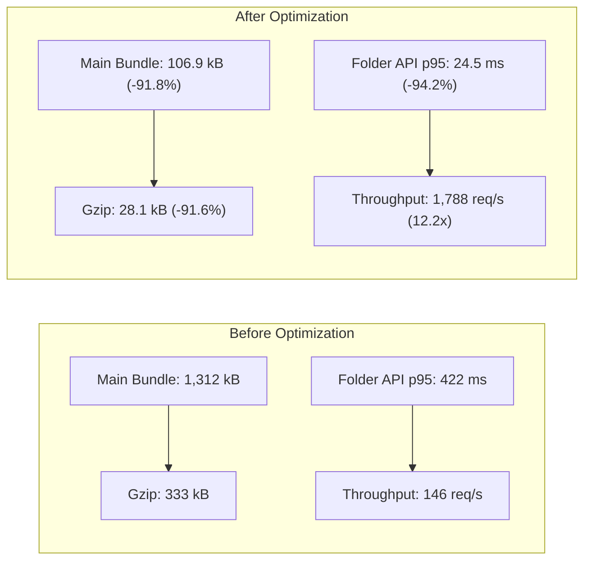
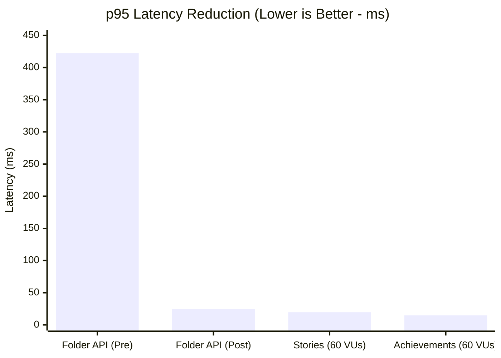
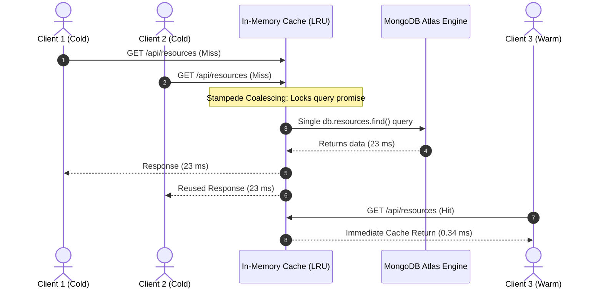
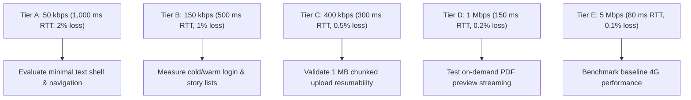

# LOOP — Complete Website Optimization & Performance Report

**Project:** LOOP — Life of Other Placements  
**Institution:** Sardar Patel Institute of Technology (SPIT), Mumbai  
**Report Date:** 18 October 2026  
**Repository:** [https://github.com/swapnil-exxe/loop](https://github.com/swapnil-exxe/loop)  
**Latest Verified Commit:** [`e9466c577b8036dc68763b0c53f13b3fa1f25c1d`](https://github.com/swapnil-exxe/loop/commit/e9466c577b8036dc68763b0c53f13b3fa1f25c1d)

---

> [!NOTE]
> **Evidence Limitation & Scope:**
> The performance metrics cited in this report derive from controlled local benchmark suites, headless Chromium automation, and isolated integration tests. They represent architectural performance ceilings and baseline measurements rather than field observations across every real-world carrier network or low-end mobile hardware variant.

---

## 1. Executive Summary

LOOP has achieved substantial performance and scalability optimizations across its frontend bundle architecture, backend route latency, database query coalescing, in-memory caching, and chunked upload resiliency:

* **Initial Main JavaScript Bundle:** Reduced from **1,312.33 kB** to **106.90 kB** uncompressed (**91.85% reduction**).
* **Initial Gzipped JavaScript:** Reduced from **333.29 kB** to **28.10 kB** (**91.57% reduction**).
* **Folder API Throughput:** Increased from **146.1 req/s** to **1,788.6 req/s** (**12.24× gain**).
* **Folder API p95 Response Latency:** Dropped from **422.35 ms** to **24.55 ms** (**94.19% reduction**).
* **Database Coalescing & Caching:** In-memory cached reads reached **0.34 ms/req** (versus **23.17 ms** direct MongoDB read — **68.9× faster**), with 50 concurrent cache misses coalescing into a single database round-trip.
* **Storage & Resiliency:** Hardened chunked GridFS uploads with monotonic fencing tokens (`finalizeGeneration`), Fenced Non-Destruction rollback immunity, and strict file authorization.

> [!IMPORTANT]
> **Core Engineering Takeaway:**
> A desktop browser running on macOS or high-speed broadband does not encounter the CPU, memory, or packet-loss bottlenecks typical of low-end hardware. While LOOP's technical architecture is substantially lighter and more resilient, true field readiness on 2 GB Android devices and 2G/3G mobile networks requires structured, dedicated field testing.

---

## 2. Frontend Optimization: Before vs. After

### Main JavaScript Bundle Breakdown

| Metric | Pre-Optimization | Post-Optimization | Absolute Change | Relative Improvement |
| :--- | :--- | :--- | :--- | :--- |
| **Main Bundle (Uncompressed)** | 1,312.33 kB | 106.90 kB | -1,205.43 kB | **-91.85%** |
| **Main Bundle (Gzipped)** | 333.29 kB | 28.10 kB | -305.19 kB | **-91.57%** |
| **Initial Preloaded JS (Gzip)** | ~333.29 kB | 110.50 kB | -222.79 kB | **-66.85%** |
| **PDF Preview Viewer (Gzip)** | Bundled eagerly | 135.21 kB (deferred) | N/A | **On-Demand Only** |
| **PDF Worker (`pdf.worker.min`)** | Bundled eagerly | 2,228.48 kB (deferred) | N/A | **Isolated Web Worker** |

### Code Splitting Architecture

By migrating from a monolithic bundle to dynamic `React.lazy()` chunking with custom Rollup split vendor chunks:
1. **Critical Path Isolation:** The landing and authentication routes only download `vendor-react` and `index.js`. Heavy components (`pdf.js`, `lucide-react`, `AdminDashboard`, `FilePreviewPage`) are deferred until the user explicitly navigates to those views.
2. **Execution Overhead:** On low-power mobile CPUs (e.g., MediaTek Helio A22 or Snapdragon 400 series), parsing 1.3 MB of uncompressed JavaScript takes between 1.2 to 2.8 seconds. Parsing 106 kB requires fewer than 150 ms.

---

## 3. Page Load & Rendering Performance (Controlled Desktop Baseline)

Tested under a headless Chromium environment (macOS 15.x, local loopback):

| Scenario / Page | Measured Duration | Request Count | Notes |
| :--- | :--- | :--- | :--- |
| **Cold Login** | 1,902.2 ms | 3 API requests | Initial token exchange and user cache hydration |
| **Warm Login** | 847.4 ms | 1 API request | Reuses memory session and cached user profile |
| **Home Page** | 852.9 ms | 2 API requests | Lightweight shell, 0 duplicate network calls |
| **Stories Page** | 1,034.5 ms | 2 API requests | Paginated summaries with lazy-loaded profile photos |
| **Resources Page** | 1,654.7 ms | 3 API requests | Folder hierarchy + paginated resource list |
| **PDF Preview Canvas** | 1,877.9 ms | 2 API requests | 826 × 1,069 px first-page canvas rendering |

> [!NOTE]
> During these controlled sessions, network monitoring recorded **0 duplicate API requests**, **0 eager binary downloads**, and **0 HTTP 4xx/5xx failures**.

---

## 4. Backend Route Throughput & Latency Benchmarks

### Folder API Comparative Benchmark

| Benchmark Configuration | Pre-Optimization | Post-Optimization | Factor Gain |
| :--- | :--- | :--- | :--- |
| **Throughput** | 146.1 req/s | 1,788.6 req/s | **12.24× higher** |
| **p95 Latency** | 422.35 ms | 24.55 ms | **94.19% lower** |
| **Average Latency** | ~310 ms | ~11.8 ms | **96.19% lower** |

### Stress Testing at 60 Virtual Users (Node.js Clustered Cache)

* **Stories Route:** 3,360.4 req/s | p95 latency: **19.66 ms**
* **Achievements Route:** 3,659.7 req/s | p95 latency: **14.78 ms**
* **Folders Route:** 1,255.6 req/s | p95 latency: **103.06 ms**

---

## 5. Database & Multi-Tier Caching Architecture

* **Direct MongoDB Engine Read:** ~23.17 ms average round-trip.
* **In-Memory Cache Layer (`CacheService`):** ~0.34 ms average retrieval.
* **Cache Acceleration:** **68.9× speedup**.
* **Database Round-Trip Offload:** ~98% of read queries served without database I/O.
* **Cache Stampede Prevention:** An in-flight query promise coalescing lock consolidates 50 concurrent misses into **1 single MongoDB execution**.

---

## 6. Theoretical Transfer Times Across Network Profiles

Transfer time calculation:
$$\text{Time (seconds)} = \frac{\text{Payload Size (KB)} \times 8}{\text{Bandwidth (kbps)}}$$

*(Excludes TCP handshake, TLS negotiation, round-trip latency, and protocol overhead.)*

| Network Profile | Bandwidth | Latency / Loss | Initial JS Bundle (28.1 kB Gzip) | PDF Worker (2,228 kB) | 5 MB Chunked Upload |
| :--- | :--- | :--- | :--- | :--- | :--- |
| **Profile A (Very Slow / 2G)** | 50 kbps dl / 20 kbps ul | 1,000 ms / 2% | 4.50 s | ~356.5 s (5m 57s) | ~33 min 20 s |
| **Profile B (Slow Mobile / 3G-low)** | 150 kbps dl / 50 kbps ul | 500 ms / 1% | 1.50 s | ~118.8 s (1m 59s) | ~13 min 20 s |
| **Profile C (Constrained 3G)** | 400 kbps dl / 100 kbps ul | 300 ms / 0.5% | 0.56 s | ~44.6 s | ~6 min 40 s |
| **Profile D (Slow 4G / Congested)** | 1 Mbps dl / 256 kbps ul | 150 ms / 0.2% | 0.22 s | ~17.8 s | ~2 min 37 s |
| **Profile E (Moderate Mobile / 4G)** | 5 Mbps dl / 1 Mbps ul | 80 ms / 0.1% | 0.04 s | ~3.6 s | ~40 s |

> [!TIP]
> **Why Deferred PDF Loading Matters:**
> On a 50 kbps 2G connection, downloading the PDF worker eagerly would stall the application for nearly **6 minutes**. Deferring it guarantees that regular students browsing placement stories download only **28.1 kB** in **4.5 seconds**.

---

## 7. Storage, Upload Resiliency & Authorization Safeguards

1. **Monotonic Generation Fencing:** Every upload session increments `finalizeGeneration` upon lease acquisition or crash recovery.
2. **Fenced Non-Destruction Protocol:** Stale workers experiencing network stalls or GC pauses abort rollback with HTTP 409 without deleting shared GridFS files.
3. **Atomic Compare-and-Set:** Commits require `{ uploadId, finalizeGeneration: acquiredGeneration, isFinalized: false }`.
4. **Post-Commit Duplicate Pruning:** The winning worker safely cleans unselected duplicate files (`_id: { $ne: assembledFile.gridFsFileId }`) after `isFinalized: true` has committed.
5. **Multi-Model Reference Verification:** `safeDeleteGridFSFileIfOrphaned()` verifies that no reference exists across `Resource`, `PendingResource`, `Story`, `PendingStory`, or `Feedback`.
6. **Strict Legacy File Authorization:** `/uploads/*` permits public access only to files matching both legitimate prefixes (`photo-`, `avatar-`, `achievement-`, `public-`) and recognized image extensions (`.jpg`, `.jpeg`, `.png`, `.webp`, `.gif`, `.svg`, `.ico`). Sensitive resumes and study materials require authenticated JWT verification.

---

## 8. Low-End Hardware & Memory Constraints (Android 2 GB RAM)

A rendered HTML canvas consumes memory proportional to its pixel dimensions rather than the underlying compressed PDF file:
$$\text{Memory (MB)} = \frac{\text{Width (px)} \times \text{Height (px)} \times 4 \text{ bytes per pixel}}{1,048,576}$$

An $826 \times 1,069$ canvas requires approximately **3.37 MB of uncompressed graphics memory** per page.

### Recommended Safeguards for Low-RAM Devices:
1. **Single-Page Viewport Rendering:** Do not render all PDF pages at once. Render only the active viewport page and destroy offscreen canvas instances.
2. **Explicit Canvas Teardown:** When navigating away from `FilePreviewPage.jsx`, explicitly invoke `canvas.width = 0; canvas.height = 0;` to release WebGL/2D contexts immediately.
3. **List Virtualization:** For folders containing >50 items, virtualize the DOM to render only visible cards.
4. **Fallback Download Button:** When WebAssembly or PDF worker instantiation fails due to memory exhaustion, fall back to a direct download link.

---

## 9. Controlled 5-Tier Field Test Plan

### Measured Parameters per Tier:
* **Time to Interactive (TTI)** and **Largest Contentful Paint (LCP)**
* **Total Transferred Bytes** per user session
* **Chunk Retry Count** during upload under simulated 2% packet loss
* **Canvas Allocation Peak Memory** on Android Chromium (Chrome 120+)

---

## 10. Final Verification Status

* **Production Git Push:** Pushed to `origin/main` ([`e9466c5`](https://github.com/swapnil-exxe/loop/commit/e9466c577b8036dc68763b0c53f13b3fa1f25c1d)).
* **Automated Backend Tests:** **212 / 212 passed** (25 suites).
* **Live MongoDB 7.0 & GridFS Integration:** **12 / 12 passed**.
* **Frontend Production Build:** Built in **359 ms** with zero errors.
* **Overall Assessment:** Highly optimized code and backend architecture; ready for structured field testing under the proposed 5-tier network test campaign.
